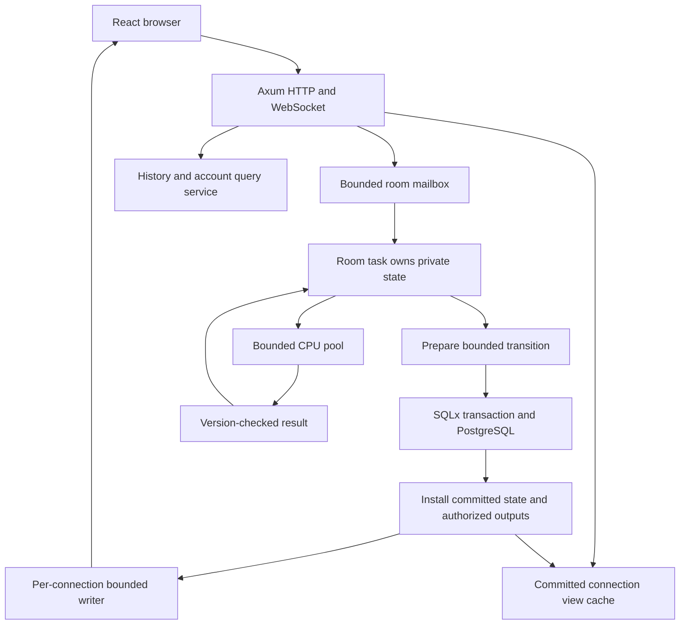

# Rust backend migration research

Research date: 2026-10-28. Repository baseline observed: `614cfa1`.
Status: original research and proposed implementation plan. The subsequent Rust
implementation and its actual verification/remaining performance boundaries are
documented in [Rust backend](rust-backend.md). The observations below record the
research baseline, not the current implementation's test status.

## Decision and scope

Move the authoritative backend to Rust, using Tokio, Axum, SQLx/PostgreSQL,
Serde, and a bounded CPU execution pool. Keep React, Vite, and the browser UI.
Use one state-owning task per room, with bounded command admission and immutable
committed viewer outputs. Start with one application owner per database.

The user explicitly accepted these migration conditions:

- Players may be required to sign in again. Do not implement an old-cookie decoder.
- The release is a one-way transition. Do not build a Node rollback path,
  reverse database migration, or a permanent dual-backend system.
- Existing accounts, games, replays, room recovery, and privacy remain in scope.
  Permission to invalidate sessions is not permission to discard these records.

The performance objective is to eliminate tracing GC in the game service and
reduce bounded foreground CPU work, queueing, and tail latency. Rust does not
eliminate allocation, deallocation, scheduler delays, database latency, or network
latency. A literal maximum of one millisecond for every operation is not a
guarantee this design can make.

## Evidence from this repository

The inspected backend contains approximately 5,776 production TypeScript lines
in 51 files, excluding test helpers. The engine adds approximately 2,462 lines in
22 files. The socket layer adds approximately 945 lines in 12 files. These counts
are scope indicators, not a translation-based effort estimate.

Relevant behavior and boundaries:

| Area | Existing implementation | Migration consequence |
| --- | --- | --- |
| Command serialization | `server/room.ts` | Preserve one writer and the post-COMMIT publication boundary |
| Persistence | `server/database.ts`, `server/room-journal.ts` | Preserve journal validation, compare-and-swap, and transactional settlement |
| Isolation | `src/lib/engine/projection.ts` | Never serialize authoritative state as a client view |
| Synchronization | `server/room-views.ts`, `src/lib/socket/stateIntegrity.ts` | Preserve atomic authorized views, epochs, revisions, and recovery |
| Room lifetime | `server/room.ts`, `server/room-membership.ts` | Connections, seats, accounts, and hosts are different entities |
| CPU work | `server/bots.ts`, `server/ratings.ts`, `server/replay-builder.ts` | Keep expensive work off network executor threads |
| Authentication | `server/auth/`, `server/account-profile.ts` | New sessions are allowed; persisted account identities must remain stable |
| Browser engine consumers | `src/lib/debug/scenarios.ts`, `src/lib/game/replayModel.ts` | Generated types alone do not replace shared executable rules |
| Deployment | `deploy/release/rollout.sh` | Remove automatic old-image restoration for the Rust cutover |

The previous local probe used Node 26.11.1, while the Dockerfile uses Node 22.
For one approximately 200 KB final ten-player game state, 100 samples produced:

| Operation | P50 | P99 |
| --- | ---: | ---: |
| Full state clone | 1.359 ms | 1.673 ms |
| Canonical JSON plus SHA-256 | 1.662 ms | 1.806 ms |
| Recursive diff between independent copies | 0.949 ms | 1.020 ms |
| Projection, hash, and JSON encoding for ten players | 3.260 ms | 3.780 ms |

Across five ten-player bot simulations, 511 sampled decisions had P50 0.550 ms,
P99 2.925 ms, and maximum 8.767 ms. These are small local CPU probes, not production
capacity measurements or evidence that GC caused those timings. They exclude SQL,
socket delivery, most room orchestration, and some publication copying.

## Framework selection

| Layer | Recommendation | Reason and boundary |
| --- | --- | --- |
| Async execution | Tokio | Network I/O, timers, channels, cancellation, task supervision primitives |
| HTTP and WebSocket | Axum with Tower middleware | Fits an HTTP-plus-WebSocket service; existing browser transport can remain |
| Database | SQLx with PostgreSQL | Explicit SQL and transactions fit the existing journal and settlement model |
| Data encoding | Serde and serde_json initially | Typed DTOs and streamed encoding; binary transport is a separate decision |
| Shared browser contracts | ts-rs | Generate public TypeScript DTOs; verify optional/null and integer semantics |
| CPU jobs | Dedicated Rayon pool with admission permits | Bounded bot/replay/checkpoint computation, separate from async I/O |
| Auth | openidconnect, async reqwest, RustCrypto AES-GCM | Reuse protocol/crypto implementations; keep provider-specific validation |
| Observability | tracing, metrics/histograms, optional tokio-console | Measure task execution, scheduling, queues, SQL, and allocations separately |
| Validation | Rust tests, proptest, Criterion, cross-language fixtures | Behavioral equivalence plus allocation and performance regression checks |

These choices reuse mature infrastructure, but do not supply a turnkey equivalent
of the current room persistence, referee, and hidden-information semantics.

Axum integrates with the Tower ecosystem and supports WebSocket limits and upgrade
handling. Its published 0.8 line is the candidate; upstream main is working toward
0.9 and should not be used as an unpinned dependency.
[Axum repository](https://github.com/tokio-rs/axum),
[WebSocket configuration](https://docs.rs/axum/latest/axum/extract/ws/struct.WebSocketUpgrade.html).

SQLx provides explicit transaction and migration APIs. Preserve the current SQL
business boundaries instead of introducing an ORM rewrite at the same time.
[Transactions](https://docs.rs/sqlx/latest/sqlx/struct.Transaction.html),
[migrations](https://docs.rs/sqlx/latest/sqlx/migrate/).

Alternatives evaluated:

- **Actix Web + actix-ws:** a reasonable alternative, including task-based
  WebSocket handling. Prefer Axum for a single Tokio/Tower composition model,
  not because an application-specific speed advantage has been demonstrated.
  [Actix WebSockets](https://actix.rs/docs/websockets/).
- **ractor:** provides actor lifecycle, supervision, RPC, and registries. Keep it
  as an option if supervision complexity grows. For this application, Tokio
  channels expose admission and transaction sequencing directly. Do not assume
  that actor restarts imply database recovery. Upstream specifically says
  `ractor_cluster` should not be considered production ready.
  [ractor](https://github.com/slawlor/ractor).
- **Lightyear/Bevy:** intended for Bevy multiplayer, including replication,
  prediction, and interpolation. This browser-based, transactional tabletop game
  does not need an ECS or movement prediction system. Introducing them would
  increase adaptation work without addressing the identified hot paths.
  [Lightyear](https://github.com/cBournhonesque/lightyear).
- **Colyseus:** no longer the authoritative runtime candidate once Rust is chosen.
  Keeping a Node room layer in front of Rust would retain a JS allocation/GC path
  and add an inter-runtime protocol. Avoid that hybrid for the initial release.

### Toolchain finding

The local toolchain is Rust/Cargo 1.91.1. Current SQLx 0.9.0 declares Rust 1.94.0
as its minimum, so the local toolchain cannot build that selected release.
The implementation spike must choose and pin a current stable toolchain meeting
all dependency MSRVs, then commit `rust-toolchain.toml` and `Cargo.lock`.
No toolchain update was performed during research.
[SQLx release manifest](https://docs.rs/crate/sqlx/0.9.0/source/Cargo.toml).

Do not mistake independently current crate versions for a verified dependency
set. Compile the combined dependency graph, database driver, TLS backend, and
Linux target in the first milestone. Run compatibility tests before selecting
optional allocator or serialization replacements.

## Runtime architecture



### Room ownership and admission

A room task owns its mutable state, timers, pending transition, and business
membership. Other tasks hold a room handle, not an `Arc<Mutex<EntireRoom>>`.
The registry briefly synchronizes room lookup/creation and must create at most
one task per room code. Never hold a registry lock across database/network awaits.

Use bounded `mpsc` for commands and response correlation through `oneshot` or an
explicit connection/request ID. A bounded channel alone is insufficient if every
input spawns an unbounded task waiting to send: reserve capacity before dispatch,
or reject/close on admission exhaustion. Bound both message count and bytes.
Retain a per-connection limit as well as a per-room limit so one client cannot
occupy all room capacity. Invalid/stale commands should fail before expensive work.
[Tokio state ownership](https://tokio.rs/tokio/tutorial/shared-state),
[bounded mpsc](https://docs.rs/tokio/latest/tokio/sync/mpsc/fn.channel.html).

Connection IDs and generations must be separate from account and player IDs.
A delayed disconnect from an old device must not disconnect its replacement.
Seat reclamation, host transfer, referee privileges, and session retirement remain
business operations inside the room's commit boundary.

### Keep heartbeats responsive while SQL is pending

Awaiting SQL inside the room task is acceptable for serial mutations: it releases
the executor thread but pauses that room's mutation processing. It must not force
heartbeats to wait behind SQL. The socket service reads a committed, authorized
view stamp from a small cache and handles transient latency separately.

A committed `watch<Arc<ConnectionView>>` is a reasonable first implementation.
Clone the Arc under a short borrow and release the watch borrow before any await.
Use generation checks to prevent a retired connection reading new private data.
The cache must never point at draft state. Evaluate ArcSwap only if measurements
show contention in this read-mostly path; do not add it by default.
[watch semantics](https://docs.rs/tokio/latest/tokio/sync/watch/),
[ArcSwap](https://docs.rs/arc-swap/latest/arc_swap/).

`watch` retains only the latest value. It is not suitable for action replies,
required notices, or a stream of patches that depend on earlier patches. The
initial migration should retain ordered full-view publication. Later coalescing
requires a separate UI/animation contract, not just a channel replacement.

### CPU and timer scheduling

There is no need for a 1000 Hz global game loop. Dispatch accepted commands on
arrival and schedule only real deadlines. Preserve the difference between UI
speech countdowns, bot action deadlines, and room/host expiry policies; a language
port must not silently make a display countdown an automatic game transition.

Use a separately configured CPU pool for bot inference, replay construction,
large recovery/checkpoint validation, and expensive encoding if profiles require
it. Limit submitted and running jobs. Rayon bounds worker count, not automatically
all pending submissions; acquire an admission permit before submitting.
Bridge results back without blocking a Tokio thread on `join` or pool `install`.

Bot jobs receive only the permitted player projection and a versioned decision
context. Check room incarnation, state/role revision, player binding, action, and
deadline when results return. Discard obsolete work; avoid unbounded retry storms.
Rating fitting should eventually run in a separate worker process/read-model
service if it competes materially with game latency.

Tokio explicitly warns that CPU-heavy futures delay other futures, that the
default blocking pool has a large thread ceiling, and that started
`spawn_blocking` jobs cannot simply be aborted. A timeout on awaiting a result is
not cancellation of the calculation. Design cooperative cancellation or a bounded
runtime for jobs and graceful shutdown.
[spawn_blocking](https://docs.rs/tokio/latest/tokio/task/fn.spawn_blocking.html),
[Rayon configuration](https://docs.rs/rayon/latest/rayon/struct.ThreadPoolBuilder.html).

Do not adopt core-pinned executors, io_uring, per-room OS threads, or custom
lock-free queues in the first release. Benchmark ordinary Tokio first.

## Memory and state model

Separate internal runtime data, persisted data, and public DTOs. They should not
all be one universal struct with `Serialize`, `Clone`, and growing nested vectors.

| Model | Suggested representation |
| --- | --- |
| GameCore | Fixed-size seat-indexed arrays, enums, counters, masks, bounded timers |
| SeatDirectory | Stable mapping from external player IDs to 0..9 slots; account/name/avatar metadata |
| GameHistory | Append-only segmented events/logs and independently stored rewind records |
| PendingTransition | Small draft core, resolved changes, history additions, settlement effects |
| CommittedView | Authorized output and stamp, stable for the duration of publication |
| PersistedRoomV1 | Compatibility DTO matching old snapshot/journal semantics |
| Public protocol DTOs | Explicit serializers for the existing browser contract |

Use a `u16` mask for ten-seat membership sets and fixed arrays for votes/roles
where useful. Keep external IDs and their historical bindings stable; a seat
index is an internal optimization, not a replacement for persisted player IDs.
Preserve the exact meaning of unclaimed, disconnected, spectator, bot, and host.

Make the small active core cheap to copy into a draft. Append history only after
commit, or stage bounded append segments with the transition. Explicitly handle
history truncation/rewind rather than assuming all business history is append-only.
Do not clone archived replay documents or phase history for a simple vote.

Allocate buffers with measured capacity, and stream typed JSON with
`serde_json::to_writer` into reusable storage. Avoid building `serde_json::Value`
trees for every action. `Bytes` can share encoded payload storage across viewers
only when their authorized bytes are identical. Do not share a full envelope
across connections with different host/referee/seat identity.
[Serde writer API](https://docs.rs/serde_json/latest/serde_json/fn.to_writer.html).

Rust allocation is still observable latency. A `Vec` growth, string formatting,
large tree destruction, final Arc drop, or contended allocator can create spikes.
Bound cache lifetimes and queue sizes, measure allocator behavior, and profile
large room teardown. Moving work to another thread also moves CPU contention;
it does not remove total work. Introduce deferred destruction only if measured,
with bounded retirement and explicit ownership of the last reference.

Begin with the platform allocator. Consider mimalloc/jemalloc only through an
application-specific comparison after structural allocation reductions. Avoid
unsafe custom arenas and borrowed buffers surviving asynchronous writes.

## Transaction and recovery design

The critical invariant remains:

```text
validate authenticated command
  -> compute draft + resolved change set
  -> acquire a pooled SQL connection
  -> transaction: owner fence + room CAS + journal + related settlement
  -> COMMIT succeeds
  -> install committed state and authorized views
  -> publish state and success response
```

No database connection is permanently reserved per room. Keep one dedicated
ownership connection initially, as today, and use the shared pool for commands.
Retain the process generation check, room version check, and stable room codes.
Multiple Tokio threads do not require multiple database owners.

Failed commands and failed transactions publish no speculative state or successful
response. A lost COMMIT response is ambiguous even in Rust: invalidate the draft,
reload authoritative state, and do not blindly retry a purchase/vote. Never infer
exactly-once execution from WebSocket ordering or an in-memory request ID.

Do not cancel a business transaction just because the client disconnects or the
HTTP request times out. Once admitted, its outcome belongs to the room state
machine. Shutdown stops admission, waits for known in-flight operations, preserves
unverified journal evidence, and only then releases ownership. Supervisor recovery
must reconcile PostgreSQL before accepting the next command.

Initially keep the existing room/journal/replay tables and V1 formats to isolate
the language migration from a storage redesign. Read old snapshots plus contiguous
journal entries and validate all recorded hashes. Generate explicit changes from
new handlers instead of rediscovering all changes via recursive diff.

The compatibility phase still has full-document hash/encoding costs. Execute large
validation/encoding work in the bounded CPU path; do not claim constant-time
commands merely because the journal entry is small. If retained hashes dominate,
introduce a separately versioned V2 representation with segmented history and
verified component hashes. A hash chain over command bytes alone is not a
replacement for validating recovered state content.

The existing checkpoint holds a room row lock while it verifies replayed history.
A later optimization can capture a consistent immutable version, verify outside
the write transaction, then use a short conditional transaction to install the
checkpoint and delete only its covered prefix. This requires fencing snapshot
anchors and room incarnation, and rejecting stale compaction after delete/recreate.
Retain current correctness until that protocol has dedicated concurrency tests.

## Compatibility that still matters

### Deterministic rules and numeric behavior

The game engine is already separated from hosting and injects time and randomness.
Port that separation. Preserve rules versions 1..5 where old event/replay handling
needs them; stored snapshots are recovered from resulting changes, not by rerunning
the current rules engine.

`src/lib/engine/rng.ts` uses xmur3 plus mulberry32, JavaScript UTF-16 code units,
wrapping 32-bit arithmetic, logical shifts, and Fisher-Yates. A standard Rust RNG
is not a compatible substitute. Use `encode_utf16`, `wrapping_*`, explicit unsigned
operations, and the same draw/shuffle order.

An isolated std-only Rust implementation was compiled with `rustc -O` and compared
against the repository's actual `createRng` through tsx:

- 108 seeds, including empty, ASCII, Chinese, emoji, and composed/decomposed accents.
- 100 draws per seed, compared as exact 32-bit integers.
- All 10,800 outputs matched.

This proves only the tested RNG stream compatibility. It does not prove engine,
shuffle call-site, weighted dealing, bot, serializer, or rating equivalence.
Floating-point log/exp implementations can differ between languages. Preserve
iteration order and tie-breakers; use differential fixtures for weighted dealing
and bots. Persist resolved roles/actions so recovery does not depend on repeating
floating-point sampling. Version intentional policy changes instead of disguising
them as a port. Rating numeric tolerances must also preserve public rounding and
threshold behavior.

### JSON hashes and persisted data

`canonicalJson` is a project-specific canonicalization function. Do not replace it
with ordinary Serde output or assume an RFC canonicalizer is byte-compatible.
Compare actual bytes and hashes for UTF-16 key sorting, string escaping, negative
zero, exponent formatting, omitted versus null fields, arrays, and timestamps.
Validate how historical data handles Unicode edge cases; Rust strings cannot
represent arbitrary lone UTF-16 surrogates as ordinary Unicode strings.

The browser checks the digest of its reconstructed authorized view. A serializer
change can therefore break a seemingly correct server even when the JSON parses.
Keep a V1 canonical compatibility encoder until a coordinated protocol revision
changes both ends. Invalid persisted data must fail closed, not be normalized into
a different state with a newly accepted hash.

### Accounts and authentication

Do not port the old encrypted session decoder. Use a new cookie name/version and
require login after cutover. Retain the provider contract: issuer allowlist,
same-origin metadata endpoint restrictions, PKCE S256, state/nonce checking,
RS256 and audience/issuer checks, userinfo subject matching, and the silent-login
callback behavior expected by the frontend. Standard OIDC support does not
automatically implement these application-specific checks.

Use an async OIDC HTTP client with bounded caches and request timeouts. Restrict
redirects and metadata destinations. Sessions should still be verified locally
for WebSocket authorization; do not contact the identity provider per action.
A new AES-GCM envelope is one option using a vetted crypto crate, unique nonces,
an explicit purpose/AAD, and the current expiry policy.
[openidconnect](https://docs.rs/openidconnect/latest/openidconnect/),
[RustCrypto AES-GCM](https://docs.rs/aes-gcm/latest/aes_gcm/).

Persisted account keys are currently the compact JSON representation of
`[normalizedIssuerOrigin, subject]`. Preserve this mapping or migrate it explicitly
across every related table. A new login must not create a second identity with
empty history, cards, role weights, or seat ownership.

Use cryptographic randomness for session tokens, room incarnation IDs, and secrets.
The compatibility game RNG is exclusively for deterministic game behavior.

### Browser contracts and executable rules

Keep existing HTTP endpoints and the `req`/`ack`/`push` WebSocket protocol in the
first Rust release. Maintain JSON error codes and `view:sync` identity/room/game
atomicity, epoch/revision/hash, notices, latency, and private notes. This lets the
existing UI and socket tests help validate the port.

Generate public DTO types with ts-rs. Use explicit Serde enum tagging and optional
field rules; generated TypeScript is not runtime validation. Internal `u64` values
must be range-checked before emitting JSON numbers consumed as JS numbers.
Do not accidentally change existing number fields to BigInt or decimal strings.
[ts-rs](https://docs.rs/ts-rs/latest/ts_rs/).

Keep browser presentation helpers and the development gallery working. Initially
freeze the TS engine as a parity oracle and gallery dependency, not as a second
production backend. Later either replace gallery simulation with a Rust/WASM core
or generated scenario fixtures; decide based on actual development requirements.
Historical replay rendering already consumes archived DTOs and some shared rules
helpers, so a whole-frontend rewrite is unnecessary.

Only introduce delta/binary synchronization if compatible JSON is still a measured
bottleneck. A V2 delta must include a base revision, new revision, atomic changes,
and a resync path. Hidden fields require explicit deletion on role/seat changes
and rewind. Required patches cannot be dropped when a client is slow; disconnect
and recover or send a complete replacement with explicit semantics.

## Suggested workspace

```text
backend/
  Cargo.toml
  Cargo.lock
  rust-toolchain.toml
  crates/
    avalon-core/       # deterministic rules, visibility, RNG; no async/SQL/network
    avalon-protocol/   # public DTOs, command validation, TS generation
    avalon-storage/    # SQLx repositories, V1 recovery, journals, migrations
    avalon-server/     # Axum, room tasks, socket/auth lifecycle, scheduling
    avalon-analysis/   # bots, replay building, ratings; CPU job implementations
  fixtures/           # synthetic/sanitized cross-language reference cases
  benches/
```

Keep modules cohesive; these are proposed boundaries, not a requirement to create
five publishable packages immediately. `avalon-core` must not depend on Tokio or
PostgreSQL. Implementing Wasm later should not require removing server assumptions
from the core.

## One-way release and data migration

1. Freeze a fixture/reference baseline and record changes made to TS during the
   port. Run Rust differential checks against that baseline continuously.
2. Exercise complete database recovery on disposable copies. Inventory legacy
   snapshots, journal formats, replay versions, and malformed records. No production
   data was read or migrated during this research.
3. Stop new room creation and command admission during the cutover window. Drain
   the old writer and retain a consistent data snapshot for recovery/verification.
4. Stop Node completely. Acquire exclusive ownership from Rust before any write.
   Run forward migrations and validate recovered state. Do not run both writers.
5. Serve the Rust backend and its matching frontend. Invalidate old sessions and
   let users sign in; restore account/seat ownership through their account identity.
6. If the release is unhealthy, remain in maintenance and repair/deploy Rust.
   Remove the current rollout script's automatic restoration of the previous image.
   Data snapshots are for integrity/recovery, not for restarting a non-Rust backend.

Checkpoint, owner-loss, and shutdown paths require explicit failure states. A room
that fails recovery should be quarantined without preventing other rooms from
recovering. An owner-connection failure must stop authoritative writes.
[Tokio shutdown pattern](https://tokio.rs/tokio/topics/shutdown).

Keep the one-owner deployment restriction initially. Horizontal scaling later
needs per-room ownership/fencing, routing, incarnation handling, and distributed
creation guarantees. Tokio concurrency alone does not remove those requirements.

## Verification and acceptance

### Behavioral gates

- Differential action traces: inputs, outputs, errors, effects, final state,
  per-player and spectator projections, and recorded replay artifacts.
- Every rules version actually present in retained data, plus empty/missing
  legacy optional fields and account-less legacy seat tokens where supported.
- Session replacement, late old-socket disconnect, host grace/transfer, room
  dissolution, notes isolation, reroll-card accounting, and referee rewind.
- Hidden-information checks over raw socket bytes, not only rendered UI.
- Journal corruption, missing versions, conflicting writes, lost COMMIT response,
  checkpoint overlap, process kill, ownership loss, and restart with no clients.
- No speculative publication while SQL or CPU prerequisites are stalled.
- Completion settlement and replay changes are transactionally consistent.

Use golden tests for exact contracts and property tests for invariants: no role
leaks, no duplicate claimed seats, conservation of roles/cards, deterministic
transitions, and recovery equivalence. Keep error behavior part of the contract.
[proptest](https://docs.rs/proptest/latest/proptest/).

### Performance gates

Distinguish these measurements:

| Metric | Meaning |
| --- | --- |
| Core execution | Pure transition CPU duration |
| Task poll duration | Continuous work before yielding on an async worker |
| Scheduling delay | Ready task to actual execution |
| Room queue delay | Accepted input waiting behind room work |
| SQL latency | Pool acquisition, queries, row-lock wait, COMMIT |
| Publication cost | Projection, hashing, encoding, enqueueing |
| Action latency | Server receive to committed acknowledgment and published state |
| Allocation | Allocation count/bytes per operation, retained heap, RSS, deallocation spikes |

Use `<1 ms P99` as an initial engineering target for bounded foreground CPU
segments under a specified workload, not a promise that complete durable actions
finish in one millisecond. Record P99.9 and maxima, and investigate outliers.
Do not move all work behind a queue and report only the now-short socket callback.
Acceptance must include end-to-end latency and admitted throughput.

Benchmark release builds on the intended Linux CPU/container limits with a real
PostgreSQL instance. Run both cold and warmed paths. Initial load ladder: 1, 10,
100, then 500 rooms only if earlier levels pass; these are test points, not capacity
claims. Test ten-player long games, 0/20 spectators per room, large single-room
spectator bursts, bot deadlines, reconnect storms, historical queries, checkpoint
bursts, slow receivers, and room destruction. Use a sustained run to observe memory
growth. A load generator must schedule requests independently of responses so
queueing stalls are not hidden by coordinated omission.

Criterion is suitable for core microbenchmarks; use a separate socket/database
harness for service latency. CPU and allocation profilers must identify whether
work moved or disappeared. Keep heavy diagnostics disabled in final timing runs.
[Criterion](https://docs.rs/criterion/latest/criterion/).

## Execution plan and effort

Estimates assume one developer familiar with Rust services and this domain,
frontend preservation, forced sign-in, one-way deployment, and single-owner
production operation. They are planning ranges, not measured delivery dates.

| Milestone | Exit condition | Person-days |
| --- | --- | ---: |
| 1. Toolchain, contracts, fixtures, service spike | Locked stack builds; real SQL + WebSocket path; baseline captured | 4-6 |
| 2. Core and privacy port | Rules, projections, RNG, referee, and compatibility fixtures pass | 9-14 |
| 3. Room runtime and durable commits | Admission, membership, journals, transactions, recovery, shutdown pass | 10-16 |
| 4. Auth, HTTP, bots, replay, history | Feature parity; new login; stable accounts; browser works | 8-12 |
| 5. Allocation and latency work | Representative load gates; bounded queues and CPU jobs | 5-8 |
| 6. Migration rehearsal and release | Data validation, one-way rollout, operational checks | 4-7 |
| Total | First production Rust backend | 40-63 |

Allow roughly 8-13 full-time working weeks. Compared with the earlier 45-75
person-day estimate, forced sign-in and removal of Node rollback reduce work,
but correctness, persistence, and frontend contract validation remain substantial.
Multi-node failover, a new wire protocol, and a browser WASM engine are separate
follow-on scope, not hidden within this estimate.

The first useful implementation milestone is a complete vertical slice:
authenticated room join, one real voting command, PostgreSQL journal commit,
authorized view publication, heartbeat during a stalled write, process restart,
and the same user's seat recovery after login. Benchmark that slice before porting
the remaining commands. RNG parity alone is not a sufficient migration prototype.

## Remaining evidence to obtain

- Target deployment CPU architecture, CPU quota, memory budget, concurrent rooms,
  typical/maximum spectators, and acceptable action latency under overload.
- A sanitized or locally generated corpus covering retained legacy formats; actual
  production schema/data inventory remains unverified.
- Cross-language canonical JSON/hash fixtures and floating-point decision parity.
- A compiled, locked integrated Rust stack on the production target.
- Measured allocation counts and end-to-end tail latency of the vertical slice.

None of these requires keeping a Node rollback implementation. They determine
whether the Rust release preserves data and actually meets its latency objectives.
